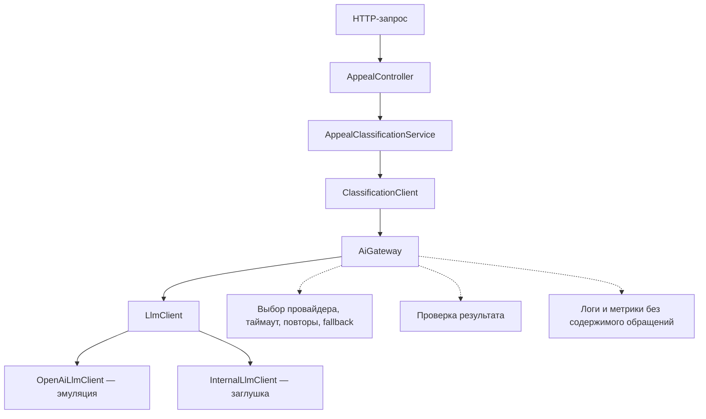

# Спецификация лабораторной работы № 1

## 1. Назначение и исходные данные

Дисциплина: «Междисциплинарный проектный практикум».

Тема: проектирование AI-ready архитектуры Spring Boot-сервиса, AI Gateway, абстракции над LLM-провайдерами и контекста для AI-ассистента.

- Студент: Иванов Юрий Сергеевич.
- Группа: ПИЖ-б-о-23-1.
- Проверяющая: Новикова Е. Н.
- Вариант: 2 — банковское приложение, классификация обращений клиентов по категориям «кредиты», «карты», «переводы».
- Репозиторий: https://github.com/y-ivanovv/workshop.git.
- Исходное задание: `Лабораторная работа 1.docx` в этой папке.

Создать небольшой REST-сервис, который принимает текст обращения и возвращает категорию. Сервис должен демонстрировать заменяемость LLM-провайдеров, обработку сбоев и пользу контекста при разработке с AI.

Этот файл фиксирует план и договорённости. Наличие пункта в спецификации не означает, что он уже реализован или проверен. На момент создания файла код и история коммитов отсутствуют.

## 2. Границы проекта и принципы простоты

Используем Java 21, Maven и Spring Boot. Конкретную совместимую версию Spring Boot фиксируем в `pom.xml` на этапе создания проекта. Основные зависимости: Spring Web, Validation, Actuator и Spring Boot Test. Для тестов используем JUnit и Mockito из тестового стартера.

В обязательный результат входят:

- один endpoint классификации;
- две реализации `LlmClient`, обе без сетевых запросов;
- AI Gateway с выбором провайдера, таймаутом, повторами и fallback;
- проверка входа и результата, безопасные логи и базовые метрики;
- тесты, документация, эксперимент с AI, разбор прототипа и отчёт.

Не добавляем базу данных, JPA, авторизацию, пользовательский интерфейс, Docker, брокер сообщений, микросервисы, RAG, векторную БД, Spring AI, Lombok, MapStruct и отдельный сервер мониторинга. Для локальной учебной демонстрации они не нужны. Не добавляем фиктивные сущности и репозитории ради заполнения пакетов.

Пишем обычные классы, небольшие методы, явные конструкторы и понятные имена. Для простых неизменяемых DTO допустимы Java `record`. Используем внедрение зависимостей через конструктор. Комментарии объясняют причины решений; инструкции запуска и описание архитектуры пишем по-русски.

Реальный LLM API, circuit breaker, ADR, интеграционные тесты с `@SpringBootTest` и CI не входят в текущий обязательный объём. Возвращаемся к ним только при отдельном расширении задачи. Бонусы из методички не должны усложнять основной проект.

## 3. Поведение классификатора и HTTP-контракт

### 3.1. Запрос и успешный ответ

`POST /api/appeals/classify`

Content-Type: `application/json`.

Запрос:

```json
{
  "text": "Как узнать остаток задолженности по кредиту?"
}
```

Ответ HTTP 200:

```json
{
  "category": "CREDITS"
}
```

| Значение | Значение для пользователя |
| --- | --- |
| `CREDITS` | Кредиты |
| `CARDS` | Банковские карты |
| `TRANSFERS` | Переводы |
| `OTHER` | Недостаточно данных для однозначной классификации |

`OTHER` — техническое дополнение к трём категориям варианта. Оно позволяет не придумывать категорию для постороннего, непонятного или неоднозначного обращения. Это успешная классификация с неопределённым результатом, а не ошибка провайдера.

Имя провайдера, число попыток и признак fallback не добавляем в публичный ответ: они нужны для диагностики и остаются внутри приложения. Проценты уверенности и объяснения не возвращаем — эмуляция не умеет обоснованно оценивать вероятность.

### 3.2. Валидация и ошибки

- `text` обязателен, не равен `null` и содержит хотя бы один непробельный символ.
- Максимальная длина исходной строки — 2000 символов по правилам Java Bean Validation.
- В начале обработки убираем пробелы по краям; регистр не влияет на эмуляцию.
- При неверном JSON, пропущенном поле, пустом или слишком длинном тексте возвращаем HTTP 400.
- Неподдерживаемый Content-Type возвращает HTTP 415, неподдерживаемый метод — HTTP 405.
- Когда оба провайдера не могут дать корректный результат, возвращаем HTTP 503.
- Неожиданная ошибка приложения даёт HTTP 500 с общим сообщением без внутренних подробностей.

Общий формат ошибки:

```json
{
  "code": "INVALID_REQUEST",
  "message": "Текст обращения должен содержать от 1 до 2000 символов"
}
```

Для недоступности классификатора используем код `CLASSIFICATION_UNAVAILABLE`. Для HTTP 415, 405 и 500 — соответственно `UNSUPPORTED_MEDIA_TYPE`, `METHOD_NOT_ALLOWED`, `INTERNAL_ERROR`. Обработчики не возвращают текст обращения, stack trace, имена Java-классов и сообщения внутренних исключений.

### 3.3. Ограничения предметной области

Сервис классифицирует текст и не выполняет банковские операции. Он не выдаёт финансовых рекомендаций, не обещает решение проблемы и не проверяет данные клиента.

Если обращение содержит признаки нескольких категорий, эмуляция возвращает `OTHER`. Например, упоминание карты и перевода одновременно требует уточнения. Это намеренно простое правило для воспроизводимого учебного результата.

## 4. Архитектура и направление зависимостей



Контроллер проверяет HTTP-вход. Сервис применяет правила обработки обращения. `ClassificationClient` преобразует задачу в запрос к LLM и скрывает формат LLM-обмена от сервиса. `AiGateway` управляет выполнением и заменой провайдера. В будущей версии только реализации `LlmClient` смогут обращаться к API конкретного LLM-провайдера.

Выделение `ClassificationClient` сохраняет требуемый в задании слой `client`. Это небольшой конкретный класс; отдельный интерфейс с единственной реализацией для него не нужен. Остальные внешние системы, например каталог банковских продуктов, не моделируем.

### 4.1. Пакеты и ответственность

Базовый пакет: `ru.ivanov.workshop`.

| Пакет | Основные элементы | Ответственность |
| --- | --- | --- |
| `controller` | `AppealController`, `ApiExceptionHandler` | HTTP, валидация DTO, статусы и единые ответы об ошибках |
| `service` | `AppealClassificationService` | Обработка обращения, вызов клиента, возврат категории |
| `client` | `ClassificationClient` | Инструкция классификации, преобразование входа и результата LLM |
| `dto` | `ClassifyAppealRequest`, `ClassifyAppealResponse`, `ApiError` | Публичные модели REST API |
| `domain` | `AppealCategory` | Четыре допустимые категории; без Spring и HTTP |
| `config` | `LlmProperties`, конфигурация исполнителя | Чтение и проверка настроек, создание необходимых компонентов |
| `llm` | `LlmClient`, `LlmRequest`, `LlmResponse`, `AiGateway`, два провайдера и исключения | Контракт генерации, эмуляция, маршрутизация и устойчивость |

Публичные DTO не передаём провайдерам. Провайдеры не зависят от контроллера, сервиса и HTTP-запроса. `domain` не зависит от остальных пакетов. Не создаём обратные ссылки и циклические зависимости.

### 4.2. Контракт LLM

Минимальный интерфейс:

```java
public interface LlmClient {
    String providerName();
    LlmResponse generate(LlmRequest request);
}
```

`LlmRequest` содержит отдельно постоянную инструкцию классификации и текст обращения. `LlmResponse` содержит типизированную `AppealCategory`. Объекты не содержат SDK-классов, URL, HTTP-заголовков и токенов конкретного провайдера.

Типизированный ответ — сознательное ограничение интерфейса задачей этой лабораторной. Универсальную платформу для генерации любых текстов не строим. При добавлении настоящего API его адаптер должен преобразовать ответ модели в `AppealCategory` и отклонить неизвестное значение.

Gateway проверяет, что ответ и категория не равны `null`. Любой некорректный ответ считается сбоем провайдера, а не превращается молча в `OTHER`. Сервис получает корректную категорию либо исключение о недоступности классификации.

## 5. Эмуляция провайдеров

### 5.1. Основной провайдер

`OpenAiLlmClient`, имя в конфигурации — `openai`.

Несмотря на название из методички, класс не отправляет запросы в OpenAI. Его JavaDoc, README и отчёт явно указывают, что это локальная эмуляция.

Алгоритм ищет в русском тексте признаки кредита, банковской карты или перевода. Основная эмуляция распознаёт небольшой документированный набор слов и словоформ. Проверяем границы слов: например, слово «картина» не должно обозначать банковскую карту. При совпадении только одной группы возвращаем её категорию, при отсутствии совпадений или нескольких группах — `OTHER`.

### 5.2. Резервный провайдер

`InternalLlmClient`, имя в конфигурации — `internal`.

Это независимая простая заглушка с более коротким набором базовых ключевых слов. Она поддерживает тот же контракт и категории. Её поведение также детерминировано и описано в README. Она не вызывает основной провайдер и не возвращает всегда одну фиксированную категорию.

Для обоих провайдеров приводим проверяемые примеры, в том числе различия в поддерживаемых формулировках. Не добавляем общий движок правил или сложную иерархию классов ради небольших алгоритмов.

### 5.3. Проверяемые ограничения

Эмуляции не понимают естественный язык как LLM: они могут ошибаться при отрицаниях, необычных формулировках и сложных обращениях. Например, фраза «Это не вопрос о кредите» может содержать ключевое слово без соответствующего намерения. Эти ограничения описываем честно; не выдаём демонстрационный алгоритм за готовый банковский классификатор.

В публичный API не добавляем переключатели ошибок, задержек и выбора провайдера. Сбои и медленные ответы моделируем тестовыми реализациями и моками `LlmClient`.

## 6. AI Gateway и обработка сбоев

### 6.1. Конфигурация

Минимальные настройки в `application.yml`:

```yaml
llm:
  active-provider: openai
  fallback-provider: internal
  timeout: 1s
  max-attempts: 2
```

`max-attempts` — общее число попыток основного провайдера, включая первую. Значение 2 означает первый вызов и один повтор. Таймаут применяется отдельно к каждой попытке, а не ко всему HTTP-запросу.

При старте проверяем существование обоих имён, их различие, уникальность имён реализаций, положительный таймаут и диапазон `max-attempts` от 1 до 3. Ошибочная конфигурация должна прерывать запуск с понятным сообщением, а не обнаруживаться первым клиентом сервиса.

Переключение `active-provider` и `fallback-provider` с перезапуском приложения не требует изменения бизнес-кода. Горячую перезагрузку конфигурации не реализуем.

### 6.2. Порядок выполнения

1. Gateway выбирает основной `LlmClient` по конфигурации.
2. Выполняет вызов с ограничением времени и проверяет результат.
3. При временной ошибке или таймауте делает повтор, если остались попытки.
4. При постоянной ошибке или некорректном результате пропускает повторы основного провайдера.
5. Если корректного результата нет, вызывает резервный провайдер один раз с тем же таймаутом.
6. При успехе возвращает результат. При сбое резерва выбрасывает исключение, которое HTTP-слой преобразует в 503.

Значение `OTHER` — допустимый результат, поэтому повтор и fallback для него не нужны. Резервный провайдер не переключается обратно на основной: рекурсии и бесконечного повторения нет. Отдельные задержки между повторами и backoff для локальной эмуляции не нужны.

Ошибки провайдера различаем небольшими явными типами исключений: временная ошибка допускает повтор; постоянная ошибка и некорректный ответ сразу ведут к fallback. Не перехватываем `Throwable` и не выдаём успешную классификацию после неожиданной ошибки программирования.

### 6.3. Настоящий таймаут без дополнительной библиотеки

Одна запись `timeout` в YAML ничего не ограничивает. Gateway должен запускать вызов через управляемый Java executor и ждать результат с `Future.get` с таймаутом. При превышении времени вызываем `cancel(true)`.

Чтобы не создавать поток на каждый запрос и не копить неограниченную очередь, используем один Spring-managed `ThreadPoolExecutor`: два рабочих потока, очередь на десять задач, отказ при переполнении. Это внутренний компонент приложения, не отдельный сервис. При завершении приложения исполнитель закрывается.

Переполнение исполнителя не запускает дополнительные повторы. Gateway может один раз попытаться вызвать резерв через тот же исполнитель; если задача также не принята, запрос завершается 503.

Эмуляции и тестовые задержки должны уважать прерывание. Если прерван ожидающий поток запроса, восстанавливаем его флаг прерывания и прекращаем обработку без повторов и fallback. Отмена Java-задачи кооперативная: код, игнорирующий прерывание, невозможно гарантированно остановить таким способом. При будущем реальном HTTP-вызове дополнительно понадобятся сетевые таймауты самого HTTP-клиента.

При свободном исполнителе верхняя граница времени ожидания провайдеров — примерно `(max-attempts + 1) × timeout`, без учёта небольших накладных расходов. Ожидание задачи в очереди входит в таймаут конкретной попытки. Эта схема рассчитана на локальную демонстрацию, а не на высокую нагрузку.

## 7. Guardrails, безопасность и наблюдаемость

Guardrails в этой работе — это конкретные проверки: ограничение входа, фиксированная инструкция, разделение инструкции и текста, закрытый список категорий, проверка результата и отсутствие банковских действий.

Текст клиента считаем данными, даже если он содержит указания «игнорируй правила» или «верни другую категорию». Эмуляция не выполняет такие указания. Это не доказывает защищённость будущей настоящей LLM от prompt injection — при реальной интеграции потребуется отдельная проверка.

Не сохраняем обращения на диск и не помещаем их в логи, метрики и исключения. Для примеров и тестов используем вымышленные тексты без ФИО клиентов, номеров счетов, карт, телефонов и других персональных данных. Распознавание и маскирование всех видов персональных данных в текущий объём не входит.

API-ключей у эмуляции нет, поэтому фиктивные ключи и ненужные переменные окружения не добавляем. Если позже появится реальный API, ключ поступает через окружение и не попадает в Git, отчёт или скриншоты. В `.gitignore` исключаем `target/`, IDE-файлы, локальные секреты и временные файлы Word.

Логируем только имя провайдера, номер попытки, длительность, исход вызова и факт перехода к резерву. Не логируем вход и ответ модели, даже на уровне DEBUG. Не печатаем исходное исключение, если его сообщение может содержать пользовательские данные.

Actuator и Micrometer используем без внешнего мониторинга:

- `/actuator/health` — проверка состояния приложения;
- `/actuator/metrics` — просмотр счётчиков и длительности;
- `llm.calls` — число попыток с тегами `provider` и `outcome`;
- `llm.call.duration` — длительность попыток;
- `llm.fallbacks` — число переходов к резерву.

`outcome`: `success`, `timeout`, `temporary_error`, `permanent_error`, `invalid_response` или `rejected`. Метрики относятся к попыткам, а не только к HTTP-запросам. Не помещаем тексты обращений, идентификаторы запросов и произвольные сообщения ошибок в теги. Открываем только health и metrics; диагностические endpoints предназначены для локального запуска.

## 8. Структура репозитория и документация

Корень проекта — текущая папка `Междисциплинарный проектный практикум`. В ней размещаем `pom.xml`, `src/` и Git-репозиторий, подключённый к указанному GitHub remote.

```text
SPEC.md
README.md
README-AI.md
.gitignore
pom.xml
src/main/java/ru/ivanov/workshop/...
src/main/resources/application.yml
src/test/java/ru/ivanov/workshop/...
docs/ai-experiment.md
docs/prototype-review.md
docs/report.docx
```

Исходную методичку сохраняем локально и не изменяем; её публикация не обязательна. Сборочные файлы, временные документы и служебные результаты проверки отчёта не отправляем в репозиторий.

`README.md` должен объяснять назначение, ограничения эмуляции, требования, команды `mvn test` и `mvn spring-boot:run`, примеры запросов в PowerShell, переключение провайдеров и просмотр метрик. Контракт API фиксируем там же. Swagger UI и отдельную OpenAPI-инфраструктуру не добавляем.

`README-AI.md` содержит структуру проекта, API-контракт и конкретные правила:

- бизнес-логика только в сервисном слое;
- Controller не вызывает Gateway, `LlmClient` и внешние API;
- сервис не выбирает провайдера и не знает его имя;
- внешние LLM доступны только через реализации `LlmClient` за Gateway;
- DTO отделены от моделей LLM и доменных типов;
- секреты и обращения не попадают в Git и логи;
- изменение API сопровождается обновлением документации и нужных тестов;
- ошибки исправляются, тесты не удаляются ради успешной сборки;
- новые зависимости и слои добавляются только при обоснованной необходимости;
- AI-предложения проверяются по заданию, коду и фактическому запуску.

## 9. Этапы разработки и критерии готовности

Этапы выполняем последовательно. Каждый этап заканчивается проверяемым результатом и отдельным содержательным коммитом. Соседние этапы можно разбить на несколько коммитов, если это отражает реальные изменения. Пустые коммиты для заполнения календаря не нужны.

| Этап | Результат | Критерий готовности | Плановая дата в метаданных Git |
| --- | --- | --- | --- |
| 1. Основа проекта | Maven-проект, точка входа, `.gitignore`, SPEC, начальный README | Приложение запускается; версии зафиксированы; лишних зависимостей нет | 22.09.2026 |
| 2. Предметная модель и контракт | Категории, DTO, интерфейс `LlmClient`, модели запроса и ответа | Контракт соответствует разделу 3; проект компилируется | 23.09.2026 |
| 3. Эмуляции и маршрутизация | Две реализации, настройки и базовый `AiGateway` | Оба провайдера дают ожидаемые категории; выбор зависит от YAML; плохие настройки выявляются при старте | 24.09.2026 |
| 4. Полный REST-сценарий | Controller, Service, ClassificationClient, обработчик ошибок | HTTP-запрос проходит все слои; валидация возвращает 400; нет прямого вызова провайдера из Controller и Service | 26.09.2026 |
| 5. Устойчивость и наблюдаемость | Таймауты, повторы, fallback, проверка ответа, executor, логи и метрики | Воспроизводимо проверены временная ошибка, таймаут и отказ резерва; чувствительных данных в логах нет | 28.09.2026 |
| 6. Проверка и правила для AI | Обязательные unit-тесты, HTTP-тесты, законченный `README-AI.md` | `mvn test` проходит; README содержит работающие команды; правила соответствуют коду | 30.09.2026 |
| 7. Эксперимент с контекстом | Два промпта, реальные ответы и сравнение в `docs/ai-experiment.md` | Сохранены исходные ответы; различия оценены по явным критериям; выводы связаны с примерами | 02.10.2026 |
| 8. Разбор AI-прототипа | Исходный прототип, проблемы и исправления в `docs/prototype-review.md` | Для каждой найденной проблемы есть доказательство, риск и исправление; отмечены принятые и отклонённые предложения AI | 04.10.2026 |
| 9. Отчёт и подготовка к защите | `docs/report.docx`, итоговый README, проверенная история и GitHub | Выполнен чек-лист раздела 13; отчёт визуально проверен; локальная и удалённая ветки совпадают | 06.10.2026 |

Тесты добавляем вместе с проверяемой логикой на этапах 2–5. Этап 6 предназначен для завершения покрытия важных сценариев, а не для откладывания всех тестов до конца.

### 9.1. История Git

По договорённости первый коммит должен иметь дату 22 сентября 2026 года, последний — 6 октября 2026 года. Для новых коммитов явно задаём даты автора и коммитера с часовым поясом `+03:00`, сохраняя последовательность этапов.

Начиная с третьего этапа выбираем для каждого нового коммита разное время с ненулевыми минутами. Уже созданные коммиты первых двух этапов не переписываем.

Это заданные метаданные Git. Они не являются доказательством фактического времени разработки и не меняют дату создания или публикации репозитория на GitHub. В отчёте не утверждаем, что реальные запуски и эксперименты происходили в эти даты, если это не подтверждено.

Сообщения коммитов коротко описывают результат, например `Добавлена классификация банковских обращений`. Не собираем всё одним финальным коммитом. До первой записи повторно проверяем remote: если там появились изменения, сначала изучаем их. Не перезаписываем чужую историю и не используем force push без отдельного основания.

## 10. Обязательные проверки

### 10.1. Классификация и сервис

- Примеры для `CREDITS`, `CARDS`, `TRANSFERS` и `OTHER`.
- Отсутствие зависимости от регистра и пробелов по краям.
- Несколько категорий одновременно дают `OTHER`.
- Сходное постороннее слово не даёт ложного совпадения, например «картина».
- Сервис проверяется с mock `ClassificationClient`, а клиент — с mock `AiGateway`.
- Service не выбирает провайдера, а Client передаёт отдельно инструкцию и обращение.

### 10.2. Gateway

- Выбранный провайдер вызывается, второй при успехе не вызывается.
- Основной провайдер может быть заменён настройкой без изменения сервиса.
- Временная ошибка вызывает ограниченное число попыток; последующий успех возвращается без fallback.
- Исчерпание попыток приводит к одному вызову резерва.
- Постоянная ошибка и некорректный ответ сразу приводят к резерву.
- `OTHER` не вызывает повторов.
- Медленный тестовый провайдер ограничивается настоящим таймаутом и получает отмену.
- Сбой обоих провайдеров завершается ошибкой недоступности.
- Прерывание ожидания останавливает работу; переполнение исполнителя обрабатывается.
- Неизвестные и одинаковые имена провайдеров, дубликаты и неверные числовые настройки отклоняются.
- Метрики отражают попытки и переходы к резерву.

Для теста таймаута используем синхронизацию и прерываемую тестовую задачу с большим запасом по времени. Не строим проверку на случайном совпадении коротких `sleep` и не используем реальные сетевые запросы. Исполнители тестов всегда закрываются.

### 10.3. HTTP и запуск

Используем `@WebMvcTest` с mock сервисом: успешный JSON, неверный JSON, отсутствующий/null/пробельный/слишком длинный текст, 405, 415 и 503. Это проверка HTTP-слоя, а не дополнительный полноценный `@SpringBootTest`.

Вручную запускаем приложение и отправляем реальные HTTP-запросы, проверяем health, метрики и смену провайдера после перезапуска. Сохраняем фактический вывод итогового `mvn test` для отчёта. Не выдумываем число тестов и результаты запусков заранее.

## 11. Эксперимент с AI и разбор прототипа

### 11.1. Влияние контекста

Для сравнения выбираем одну и ту же модель, по возможности одинаковые настройки и два независимых диалога без истории друг друга. Эксперимент касается генерации программного решения, а не ответов нашего эмулятора на обращения.

Первый запрос содержит только задачу по варианту. Второй содержит ту же задачу и контекст: API-контракт, пакеты, ограничения, правила безопасности и тестирования, минимальный LLM-контракт. В первом запросе не требуем специально написать плохой код и не подсказываем ожидаемые дефекты.

В `docs/ai-experiment.md` записываем:

1. Фактическую дату, инструмент и название модели, если оно доступно.
2. Оба полных промпта и ответы в исходном виде; существенные фрагменты не переписываем задним числом.
3. Сравнение: разделение слоёв, заменяемость провайдера, валидация, ошибки, секреты, логи, тесты, понятность кода и соответствие контракту.
4. Конкретные примеры улучшений, оставшихся ошибок и предложений, которые решено отклонить.
5. Вывод автора работы о влиянии контекста. Два ответа не дают статистического доказательства превосходства одного подхода.

Эмуляция провайдеров не заменяет этот эксперимент. Ответы для него должны быть реально получены от AI. Не приписываем модели выдуманные ошибки и не утверждаем, что контекст обязательно улучшил каждый критерий.

### 11.2. AI-прототип

Можно использовать исходный прототип из первого ответа, если он содержит достаточно кода для анализа. Иначе отдельно запрашиваем небольшой первоначальный прототип и сохраняем его промпт и ответ.

В `docs/prototype-review.md` приводим код прототипа и разбор: место проблемы → нарушенное правило → риск → исправление → способ проверки. Проверяем смешение слоёв, прямой вызов LLM, привязку к провайдеру, секреты, таймауты, повторы, fallback, валидацию, логи, тесты и контракт.

Не объявляем отсутствующей проблему, которую исходный AI уже решил. Если для иллюстрации нужен намеренно упрощённый пример, явно называем его учебным примером и не подменяем им исходный ответ. Прототип с плохими практиками храним как листинг Markdown, а не как работающий production-код в `src/main`.

## 12. Отчёт и защита

Отчёт создаём по образцу соседних работ DevOps. Для титульного листа используем СКФУ, Институт перспективной инженерии, Департамент цифровых, робототехнических систем и электроники, направление 09.03.04 «Программная инженерия», Ставрополь, 2026 год. ФИО, группу и проверяющую берём из раздела 1; должность проверяющей не придумываем.

Обязательные разделы:

1. Титульный лист с номером работы, дисциплиной и вариантом.
2. Цель и задачи.
3. Предметная область, вход, выход и ограничения варианта.
4. Диаграмма AI Gateway: слои, провайдеры, guardrails и проверка результата.
5. Обоснование архитектуры и листинги ключевых классов и конфигурации.
6. Правила `README-AI.md`.
7. Сравнение двух контекстов с промптами, ответами и анализом.
8. Разбор AI-прототипа, исправления и риски production-применения.
9. Тесты и фактические результаты запуска.
10. Выводы: ограничения, ошибки AI, принятые и отклонённые предложения, самостоятельно проверенные свойства.
11. Ответы на все 15 контрольных вопросов с примерами из проекта.
12. Использованные источники и ссылка на GitHub.

При подготовке документа проверяем его страницы визуально: диаграмма и код читаемы, таблицы не обрезаны, нет пустых страниц и испорченных переносов. Скриншоты, если используются, получаем из реального запуска без секретов.

К защите студент должен уметь:

- запустить приложение и тесты;
- отправить запрос и объяснить ответ;
- проследить путь запроса через слои;
- объяснить интерфейс, реализацию, DTO, enum и внедрение зависимостей;
- переключить провайдера настройкой;
- показать на тестах повтор, таймаут и fallback;
- объяснить ограничения эмуляции и отличие `OTHER` от ошибки;
- привести реальную ошибку или неудачное предложение AI и объяснить исправление.

## 13. Итоговые критерии готовности

- [ ] Проект собирается и запускается по README на Java 21 через Maven.
- [ ] REST-контракт соответствует спецификации; ошибки имеют стабильные коды и HTTP-статусы.
- [ ] Реализованы все требуемые пакеты с содержательной ответственностью.
- [ ] Controller и Service не вызывают LLM напрямую и не выбирают провайдера.
- [ ] Есть две реализации `LlmClient`, выбор через YAML и валидация конфигурации.
- [ ] Таймаут, ограниченные повторы, fallback и отказ обоих провайдеров проверены.
- [ ] Вход и результат проверяются; обращения и секреты не сохраняются и не логируются.
- [ ] Есть безопасные логи и работающие базовые метрики.
- [ ] Тесты обязательных сценариев проходят; результаты соответствуют фактическому запуску.
- [ ] `README.md`, `README-AI.md` и `SPEC.md` согласованы с реализацией.
- [ ] Сохранены настоящие промпты и ответы AI, сравнение и разбор прототипа.
- [ ] Отчёт содержит все обязательные разделы и ответы на 15 вопросов.
- [ ] Ограничения эмуляции и принятые упрощения явно описаны.
- [ ] Первый и последний коммиты имеют согласованные даты; каждый коммит отражает содержательный этап.
- [ ] Итоговая ветка отправлена в `y-ivanovv/workshop`; Git не содержит секретов, сборочных и временных файлов.
- [ ] Студент понимает основной код и может воспроизвести демонстрацию.

## 14. Ход выполнения

- [x] Этап 1 — основа проекта.

Созданы `pom.xml`, точка входа `WorkshopApplication`, `application.yml`, `.gitignore` и начальный `README.md`. Зафиксированы Java 21 и Spring Boot 3.5.16. Подключены четыре зависимости из раздела 2; бизнес-логика последующих этапов пока не реализована.

Фактическая проверка выполнена 17 ноября 2026 года:

- `mvn clean package` завершилась с `BUILD SUCCESS`.
- Собранный JAR запущен на `127.0.0.1:8080`.
- `/actuator/health` вернул `{"status":"UP"}`.
- `/actuator/metrics` вернул список метрик, включая `jvm.memory.used`.
- После проверки приложение остановлено.
- Unit-тестов пока нет: на этом этапе проверены сборка и запуск основы.

Дата первого коммита в метаданных Git — 22 сентября 2026 года, согласно разделу 9.1.

- [x] Этап 2 — предметная модель и контракты.

Добавлены `AppealCategory`, публичные DTO `ClassifyAppealRequest`, `ClassifyAppealResponse`, `ApiError`, интерфейс `LlmClient` и внутренние модели `LlmRequest` и `LlmResponse`. Текст запроса ограничен аннотациями `@NotBlank` и `@Size(max = 2000)`. Инструкция и текст обращения разделены в `LlmRequest`. Доменные категории не зависят от Spring и HTTP; модели провайдера не зависят от публичных DTO.

Фактическая проверка выполнена 17 ноября 2026 года:

- `mvn clean package` завершилась с `BUILD SUCCESS`.
- Выполнено 14 тестов: ошибок, неуспешных и пропущенных тестов нет.
- Проверены `null`, пустые и пробельные строки, длины 1 и 2000, превышение лимита до удаления пробелов по краям.
- Проверены чтение JSON-запроса, отсутствие поля `text`, JSON-ответы для четырёх категорий и формат `ApiError`.

DTO пока описывают будущий HTTP API: сам endpoint будет реализован на этапе 4. Валидация сейчас запускается в тестах; в контроллере она будет подключена через `@Valid`. Реализации провайдеров и Gateway пока не добавлены.

Дата коммита второго этапа в метаданных Git — 23 сентября 2026 года.

- [x] Этап 3 — эмуляции провайдеров, настройки и базовая маршрутизация.

Добавлены `OpenAiLlmClient` и `InternalLlmClient`: обе реализации локальные, без API-ключей и сетевых вызовов. Первая распознаёт документированный набор словоформ и ипотеку, вторая — три базовых слова. Регистр и пробелы по краям не влияют на результат; совпадения проверяются по целым словам. Несколько распознанных категорий или отсутствие совпадений дают `OTHER`.

`LlmProperties` читает раздел `llm` из `application.yml`. Проверяются имена, положительный таймаут и число попыток от 1 до 3. `AiGateway` собирает реализации по именам, отклоняет дубликаты, неизвестные и одинаковые имена основного и резервного провайдера, затем направляет запрос выбранной реализации. Правила и ограничения эмуляций, примеры и способ переключения описаны в README.

Фактическая проверка выполнена 17 ноября 2026 года:

- `mvn clean package` завершилась с `BUILD SUCCESS`.
- Выполнено 57 тестов: ошибок, неуспешных и пропущенных тестов нет.
- Проверены категории, словоформы, регистр, неоднозначные обращения и ложные совпадения вроде «картина».
- Подтверждён выбор обеих реализаций через настройки: «Нужна ипотека» даёт `CREDITS` через `openai` и `OTHER` через `internal`.
- Проверены ошибки запуска при неверных настройках; использован небольшой Spring-контекст без `@SpringBootTest`.
- Собранный JAR успешно запущен с настройками YAML; `/actuator/health` вернул `{"status":"UP"}`. Проверочный процесс остановлен.

На этом этапе Gateway выполняет только маршрутизацию. Резерв, таймаут и число попыток читаются и проверяются, но пока не применяются к выполнению запросов. Обработка сбоев, проверка ответа провайдера и метрики LLM остаются на этапе 5.

Дата автора и коммитера третьего этапа — 24 сентября 2026 года, 14:37 МСК. Следующий шаг — этап 4, полный REST-сценарий: Controller, Service, ClassificationClient и обработчик HTTP-ошибок.
