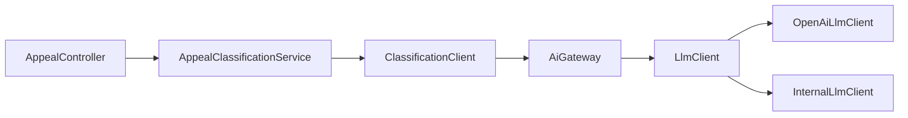

# Инженерный разбор AI-прототипа

Прототип из ответа без контекста содержит полезную основу отдельного сервиса, но для нашей лабораторной требует адаптации API, границ слоёв, провайдеров, устойчивости и диагностики. Ниже разобраны восемь направлений доработки с рисками, исправлениями и способами проверки.

## Источник и способ проверки

Использован [полный исходный ответ A](ai-experiment/without-context.response.md), полученный на [промпт без контекста](ai-experiment/without-context.prompt.md) в эксперименте этапа 7. Условия генерации описаны в [ai-experiment.md](ai-experiment.md). Повторно генерировать или намеренно ухудшать прототип не потребовалось.

Фактическая дата разбора — 17 ноября 2026 года. Базовый коммит проекта перед этим этапом — `62c6ee7b4730f1c827d075eaf7b483da275d070a`. Дата 4 октября относится к метаданным коммита этапа, а не к фактическому времени анализа.

Исходный ответ не редактировался. Его SHA-256 для текста UTF-8 без BOM с переводами строк LF:

```text
4046138e266b58a25f8a267c825c4d02722d5b227aa2acd100c8bb8bae43a307
```

Проведён статический разбор листингов и их сопоставление с SPEC, README-AI и существующими классами и тестами проекта. Прототип A не собирался и его тесты не запускались. Наблюдение в коде, риск и подтверждённый результат запуска различаются. Предыдущие 111 успешных тестов относятся к инженерной реализации проекта, а не к A.

## Ключевые фрагменты прототипа

Это дословные фрагменты исходного ответа. Полный код, конфигурация и предложенные тесты находятся в приложенном исходнике.

Абстракция обращения к модели:

```java
package ru.example.bankclassifier;

import java.util.Optional;

public interface LlmGateway {
    Optional<Category> classify(String text);
}
```

Сервис:

```java
package ru.example.bankclassifier;

import org.springframework.stereotype.Service;

@Service
public class ClassificationService {
    private final LlmGateway gateway;

    public ClassificationService(LlmGateway gateway) {
        this.gateway = gateway;
    }

    public Category classify(String text) {
        return gateway.classify(text.strip())
                .orElseThrow(UnclassifiableException::new);
    }
}
```

Контроллер:

```java
package ru.example.bankclassifier;

import jakarta.validation.Valid;
import org.springframework.web.bind.annotation.*;

@RestController
@RequestMapping("/api/classifications")
public class ClassificationController {
    private final ClassificationService service;

    public ClassificationController(ClassificationService service) {
        this.service = service;
    }

    @PostMapping
    public ClassificationResponse classify(
            @Valid @RequestBody ClassificationRequest request) {
        return new ClassificationResponse(service.classify(request.text()));
    }
}
```

## Что уже сделано правильно

- Controller вызывает Service, а не HTTP API модели. Конкретный сетевой вызов вынесен в `OpenAiLlmGateway` за интерфейсом.
- Используются конструкторы для зависимостей, DTO, `@Valid`, `@NotBlank` и ограничение длины. Лимит 4000 отличается от нашего, но отсутствие валидации прототипу приписывать нельзя.
- Ключ берётся из `${LLM_API_KEY}`. Это ссылка на переменную окружения, а не опубликованный секрет.
- Заданы таймаут соединения 2 секунды и таймаут чтения 15 секунд.
- Проверяются структура ответа LLM, `finish_reason`, допустимые значения категории, лишние поля, повторяющиеся ключи и данные после JSON.
- Инструкция и обращение передаются отдельными сообщениями system/user. Автор не обещает, что это гарантирует защиту от prompt injection.
- Предложены тесты Service, HTTP API и адаптера с `MockRestServiceServer`, включая ответ 429 и имитацию `SocketTimeoutException`.
- Неопределённая тема отделена от сбоя провайдера. В ответе явно сказано, что код и тесты не запускались.

Поэтому формулировки «секрет зашит в YAML», «контроллер напрямую вызывает LLM», «нет таймаутов» и «нет тестов» для этого источника неверны. Расхождения с требованиями, которых не было в коротком промпте, также не означают, что модель должна была их угадать.

## Восемь направлений доработки

### 1. Публичный контракт и предметные правила отличаются от согласованных

**Место и наблюдение.** `ClassificationController` задаёт `/api/classifications`. `Category` сериализуется через `@JsonValue` в русские названия; запрос допускает 4000 символов. `Optional.empty()` превращается в 422. Ошибки оформлены через `ProblemDetail`, а не наш `ApiError` с `code/message`. В `SYSTEM_PROMPT` отдельно установлен приоритет перевода при упоминании карты.

**Правило и риск.** Наш контракт — `/api/appeals/classify`, коды `CREDITS/CARDS/TRANSFERS/OTHER`, максимум 2000 символов и HTTP 200 для `OTHER`. При механической замене клиент попадёт на другой маршрут или не сможет прочитать категорию. Новое правило приоритета изменит распределение обращений. Для отдельного сервиса решения A допустимы, но они не согласованы с нашей системой.

**Исправление.** Сохранить существующие `AppealCategory`, публичные DTO и маршрут. Оставить доменный enum без Jackson-аннотаций; представление ответа задаётся DTO. Неопределённость возвращать как `OTHER`, сбой — отдельной ошибкой. Предметные приоритеты менять только вместе с контрактом и примерами.

**Проверка.** В `AppealControllerTest` есть точная проверка ответа `returnsOnlyCategoryForValidRequest`, границ длины и формата ошибок. `LlmEmulationTest` проверяет несколько тем и `OTHER`. Это существующие проверки нашей реализации; поведение настоящей LLM по тексту её инструкции здесь не считается измеренным.

### 2. Нет требуемой границы ClassificationClient и правил пакетов

**Место и наблюдение.** Все типы A расположены в `ru.example.bankclassifier`. `ClassificationService` зависит от интерфейса `LlmGateway`. Отдельного `ClassificationClient` и внутренних `LlmRequest/LlmResponse` нет. Постоянная инструкция `SYSTEM_PROMPT`, включая предметное правило приоритета переводов, находится внутри конкретного HTTP-адаптера `OpenAiLlmGateway`.

**Правило и риск.** В нашей архитектуре Service знает клиентский слой, Client готовит инструкцию, Gateway управляет выполнением, а провайдер реализует LLM-контракт. Интерфейс A уже уменьшает связь с конкретным поставщиком, поэтому это не прямой вызов OpenAI из бизнес-логики. Однако при добавлении другого адаптера придётся переносить или дублировать инструкцию с предметными правилами. Смена модели не должна неявно менять правило классификации. Нужные границы и места будущих изменений следует выразить отдельно.

**Исправление.** Использовать пакеты `controller`, `service`, `client`, `dto`, `domain`, `config`, `llm` и текущую цепочку классов. Инструкцию формировать в `ClassificationClient`. Зафиксировать разрешённые зависимости и запреты в `README-AI.md`. Дополнительный интерфейс для единственного ClassificationClient не нужен.

**Проверка.** `AppealClassificationServiceTest` подменяет только ClassificationClient, а `ClassificationClientTest` — Gateway и проверяет разделение инструкции и текста. Чтение импортов и вызовов подтверждает направление зависимостей; отдельный архитектурный фреймворк не добавляется.

### 3. Показан только один внешний провайдер

**Место и наблюдение.** Есть одна реализация `OpenAiLlmGateway`, которая отправляет HTTP-запросы в API формата Chat Completions. Настройки задают URL, ключ и модель; второго провайдера и выбора двух реализаций нет.

**Правило и риск.** Для лабы нужны минимум две реализации LlmClient и выбор по конфигурации. Наш запуск должен обходиться без ключей и сети. У A интерфейс допускает замену адаптера, а URL можно поменять для совместимого API; это частичная защита от зависимости от поставщика. Но отказ или ограничение текущего сервиса всё равно оставит классификацию без альтернативы. Несовместимый API потребует другого адаптера, а вызовы внешней модели могут иметь стоимость.

**Исправление.** Использовать существующие `OpenAiLlmClient` и `InternalLlmClient` как локальные эмуляции, общий `LlmClient`, `LlmProperties` и регистрацию по `providerName()`. Имена основного и резерва задаются в YAML, проверяются при старте и не попадают в бизнес-логику.

**Проверка.** `LlmConfigurationTest.selectsProviderUsingConfiguration` меняет настройки и получает разные ожидаемые результаты. Там же проверяется отказ запуска с неизвестными и одинаковыми именами. В `AiGatewayTest` проверяются дубликаты и пустое имя реализации.

### 4. Отсутствует требуемая политика повторов и fallback

**Место и наблюдение.** Автор A прямо исключает автоматические повторы из-за задержки и стоимости. После ошибки HTTP-вызова адаптер выбрасывает `LlmUnavailableException`; резервной реализации нет.

**Правило и риск.** Это сознательный компромисс A, но он не выполняет обязательную часть нашей лабы. Единичный временный сбой сразу приводит к недоступности для клиента. Обратная крайность — бесконечные повторы — увеличит задержку и число оплачиваемых обращений, поэтому просто добавить любой retry тоже неверно.

**Исправление.** Сохранить нашу ограниченную политику: `max-attempts` включает первый вызов основного провайдера; повторяются только временные ошибки и таймауты. Постоянная ошибка или неправильный ответ сразу ведут к одному вызову резерва. Ожидаемый отказ резерва даёт 503. Корректный `OTHER` не повторяется.

**Проверка.** `usesReserveOnceAfterExhaustingPrimaryAttempts` проверяет лимиты 1/2/3, `retriesTemporaryErrorAndReturnsNextSuccess` — восстановление после временного сбоя, `returnsValidCategoryWithoutRetryOrFallback` — в том числе `OTHER`. Отказ резерва проверяется с несколькими типами ошибок без его повторения.

### 5. Сетевые таймауты не заменяют ограничение нагрузки на LLM

**Место и наблюдение.** В A есть `connectTimeout` и `setReadTimeout`, но нет отдельного исполнителя, ограниченной очереди и политики отказа принять новый вызов LLM. `RestClient` вызывается синхронно из обработки обращения.

**Правило и риск.** При всплеске запросов обработчики будут ждать внешнюю модель. Ограничения веб-сервера сами по себе не выражают требуемый бюджет LLM. Наличие сетевого таймаута не доказывает реализацию нашего таймаута каждой попытки и отмены задачи. Неверно называть ожидание A бесконечным: его сетевые ограничения уже заданы.

**Исправление.** В учебной версии использовать один Spring-managed исполнитель с двумя потоками и очередью на десять задач. Ждать каждую попытку через `Future.get` с таймаутом; отменять её через `cancel(true)` и удалять из очереди. Переполнение не повторяет основной вызов. Прерывание останавливает обработку, исполнитель закрывается вместе с приложением. При будущем реальном HTTP-адаптере его сетевые таймауты также сохраняются.

**Проверка.** В `AiGatewayTest` есть проверки медленной задачи, времени в очереди, удаления отменённых задач, переполнения и прерывания. `closesExecutorWithSpringContext` проверяет завершение исполнителя. Отмена остаётся кооперативной: код, игнорирующий прерывание, нельзя объявлять гарантированно остановленным.

### 6. Разные причины недоступности объединены в один тип ошибки

**Место и наблюдение.** `OpenAiLlmGateway.classify` превращает `RestClientException` и `JsonProcessingException` в один `LlmUnavailableException`. Этот же тип используется для неправильной структуры ответа и неизвестного значения категории. Во внешний ответ не передаются детали — это правильно, но внутри теряется различие ожидаемых причин.

**Правило и риск.** Gateway не сможет выбрать между повтором временного сбоя, немедленным резервом и исправлением настроек. Число одинаковых 503 не объяснит, где проблема: в доступности провайдера или в формате результата. При этом `UNKNOWN` у A отделён через Optional, поэтому его нельзя ошибочно считать такой же ошибкой.

**Исправление.** Внутри приложения различать `TemporaryLlmException`, `PermanentLlmException` и `InvalidLlmResponseException`; таймаут и отказ исполнителя учитывать отдельно. Публичный 503 остаётся общим и безопасным. Неожиданная ошибка программирования не должна запускать резерв или подменяться `OTHER`; для неё сохраняется безопасный 500.

**Проверка.** `skipsRetriesForPermanentError`, `switchesToReserveForInvalidResponse`, `returnsUnavailableWhenReserveAlsoFailsWithoutRetryingIt` и `doesNotHideProgrammingErrorBehindFallback` проверяют разные маршруты обработки и число вызовов. В HTTP-тестах проверяются безопасные 500 и 503 без исходных сообщений исключений.

### 7. Наблюдаемость описана как дальнейшая работа

**Место и наблюдение.** В A мониторинг задержек и ошибок упомянут в конце, но кода счётчиков, таймеров и безопасных записей о попытках нет. `log-request-details: false` уменьшает подробность HTTP-логирования, но не заменяет метрики LLM.

**Правило и риск.** Оператору трудно увидеть частоту и длительность сбоев, отделить ошибку провайдера от успешного результата и отследить срабатывание резерва. Если позже начать диагностировать проблему печатью исходных запросов и исключений, можно раскрыть клиентские данные или секреты. Самой такой утечки в исходном коде A не показано.

**Исправление.** Использовать уже подключённые в инженерной версии Actuator и Micrometer: `llm.calls`, `llm.call.duration`, `llm.fallbacks`. В логах только имя провайдера, номер попытки, исход, длительность и факт fallback. В теги не добавлять текст, идентификаторы запросов и произвольные сообщения ошибок.

**Проверка.** `logsAndMetricsExcludePayloadAndExceptionDetails` проверяет секретный маркер, теги и события таймера. Счётчики попыток проверяются в сценариях Gateway. На этапах 5–6 метрики также проверены через HTTP. На этом документальном этапе новые результаты запуска не заявляются.

### 8. Строгие типы входного JSON и пограничные ответы не закреплены

**Место и наблюдение.** DTO A имеет поле `String text`, `@NotBlank` и `@Size`, но отдельного запрета автоматического преобразования числа или boolean в строку не показано. Предложенные HTTP-тесты не включают эти случаи, 405/406/415 и неожиданный 500. Тест имитации `SocketTimeoutException` проверяет обработку ошибки, а не измеряет реальное соблюдение лимита времени.

**Правило и риск.** Аннотации проверяют уже полученную Java-строку, а не исходный тип JSON-токена. В нашем стеке неявное преобразование уже обнаруживалось на этапе 6. Для отдельного A на его версиях библиотек это риск, который требуется воспроизвести тестом; здесь не утверждается, что его запуск подтвердил такой ответ. Допустимый вход и формат ошибок должны быть явными, иначе клиенты могут получить неожиданное поведение.

**Исправление.** Сохранить текущую `JsonConfiguration`, `@Valid` до вызова Service, общий `ApiExceptionHandler` и строгий JSON Content-Type ошибок. Дополнить матрицу тестов отсутствующим телом, неправильными типами JSON, границами 1/2000/2001, служебными HTTP-статусами и реальным ограничением ожидания через управляемый тестовый провайдер.

**Проверка.** В текущем `AppealControllerTest` есть `rejectsInvalidBodyBeforeCallingService`, граничные длины, безопасные ошибки и сохранение `Allow` для 405. Задержки и отмена проверяются через latch в Gateway. Само наличие предложенных тестов A не означает, что они успешно выполнились; автор A это прямо оговаривает.

## Инженерная версия и предотвращающие правила

Доработки уже представлены реализацией этапов 1–6; этот разбор не выдаёт их за новые изменения исходного AI-ответа.



Реальные классы, на которые опирается доработка:

- [AppealController](../src/main/java/ru/ivanov/workshop/controller/AppealController.java) и [ApiExceptionHandler](../src/main/java/ru/ivanov/workshop/controller/ApiExceptionHandler.java) сохраняют публичный контракт.
- [AppealClassificationService](../src/main/java/ru/ivanov/workshop/service/AppealClassificationService.java) и [ClassificationClient](../src/main/java/ru/ivanov/workshop/client/ClassificationClient.java) разделяют обработку обращения и подготовку LLM-запроса.
- [LlmClient](../src/main/java/ru/ivanov/workshop/llm/LlmClient.java), [AiGateway](../src/main/java/ru/ivanov/workshop/llm/AiGateway.java) и [LlmProperties](../src/main/java/ru/ivanov/workshop/config/LlmProperties.java) обеспечивают заменяемость и управление попытками.
- [LlmExecutionConfiguration](../src/main/java/ru/ivanov/workshop/config/LlmExecutionConfiguration.java) задаёт ограниченный исполнитель, а [JsonConfiguration](../src/main/java/ru/ivanov/workshop/config/JsonConfiguration.java) — строгий тип строкового входа.

В [README-AI.md](../README-AI.md) закреплены конкретные правила, предотвращающие повторение проблем:

1. Внешние вызовы LLM разрешены только в реализации LlmClient за Gateway. Controller вызывает Service, Service — ClassificationClient.
2. Подготовка инструкции находится в Client, маршрутизация и устойчивость — в Gateway. Доменные типы не зависят от HTTP и Spring.
3. Публичный API, правила категорий и валидация не меняются без обновления документации и соответствующих тестов.
4. Новый провайдер обязан соблюдать общий контракт; секреты не входят в DTO, YAML и Git.
5. Повтор разрешён только для обозначенных временных ошибок и таймаутов; число попыток ограничено, резерв вызывается один раз.
6. Executor, очередь, отмена и закрытие ресурсов входят в реализацию таймаута, а не заменяются одной настройкой YAML.
7. Диагностика содержит только разрешённые технические поля. Запросы, ответы и сообщения исключений не логируются и не становятся тегами.
8. Поведение подтверждается тестами с моками и управляемыми задержками. Неуспешный тест нельзя удалить ради успешной сборки.

## Риски выхода в production

| Риск | Основание в прототипе | Что нужно решить перед реальным внедрением |
| --- | --- | --- |
| Зависимость от поставщика | Одна реализация и конкретный HTTP-формат | Проверить заменяемость адаптеров, доступность и политику перехода к другой модели |
| Стоимость | Каждый вызов обращается к внешней модели; повторы увеличат число обращений | Установить допустимые лимиты и контролировать фактическое потребление; не обещать бесплатность API |
| Конфиденциальность | Полный текст передаётся в пользовательское сообщение внешней модели | Согласовать допустимые данные и модель, исключить ненужные реквизиты; одной раздельной роли system/user недостаточно |
| Недоступность под нагрузкой | Синхронный внешний вызов без отдельного лимита одновременных LLM-запросов | Проверить ограничение нагрузки, задержки, очередь, отмену и поведение при отказе |
| Недостаточная диагностика | Метрики лишь рекомендованы | Проверить технические показатели и отсутствие чувствительных данных в диагностике |
| Неверная категория | Проверка формы JSON не измеряет смысловую точность модели | Использовать размеченные вымышленные примеры, спорные темы, отрицания и попытки внедрить инструкции |

Сам A также отмечает необходимость защиты входящего HTTP, ограничения размера тела до десериализации и согласованной политики данных. Эти замечания сохраняются: `@Size` проверяет строку после чтения JSON. Наши локальные эмуляции и лимит 2000 тоже не доказывают готовность к реальной банковской нагрузке и не заменяют ограничения размера тела на входе.

Аутентификация, отдельное ограничение частоты запросов и работа с настоящими клиентскими данными выходят за текущий объём лабы. На этом этапе не добавлялись БД, Docker, очереди сообщений, внешние модели и новые зависимости. Учебный сервис демонстрирует архитектурные механизмы; production-готовность из этого не следует.

## Принятые решения и вывод

Из A сохранены идеи разделения HTTP и провайдера, общего интерфейса, ключей через окружение для возможного будущего API, проверки результата, безопасных ошибок и тестов без реальной модели. Отказ от случайной категории для неопределённого обращения также полезен, но у нас выражается через `OTHER`.

Отклонены обязательный внешний API, другой маршрут и формат категорий, лимит 4000 и 422 вместо нашего `OTHER`. Это решения для другого контракта, а не универсально плохие практики. Прямое копирование прототипа заменено сопоставлением с требованиями и уже проверенной инженерной реализацией.

Основной вывод: работающий по замыслу AI-прототип ещё нужно согласовать с конкретной системой. В этом примере важнее сохранить его удачные решения и добавить недостающие границы, политику сбоев и проверяемость, чем объявить весь ответ плохим. Исходник остаётся неизменным свидетельством ответа AI, а исправления и их обоснование — отдельным инженерным результатом.
